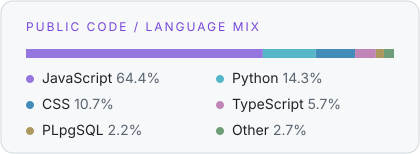

<div align="center">

<!-- Animated Header -->
  

</div>
<div align="center">

<!-- Typing Animation -->
<a href="https://git.io/typing-svg">
  
</a>

<br/>

[](https://github.com/oceankumar)
[](https://www.linkedin.com/in/oceankumar/)
[](mailto:oceankumar107@gmail.com)

<br/>


</div>

---

### 🧑‍💻 About Me

```javascript
const ocean = {
  location: "India 🇮🇳",
  education: "B.Tech in Computer Science & AI",

  currently: [
    "Full-Stack Developer @ Adhyaapan",
    "Building AI-powered products and full-stack applications"
  ],

  previously: [
    "LLM Trainer @ Handshake"
  ],

  roles: [
    "Full-Stack Developer",
    "AI Product Developer",
    "Open Source Contributor",
    "Microsoft Student Ambassador",
  ],
};
```

CS & AI student building useful software across **AI integrations, APIs, and full-stack systems**. A builder's mindset, with a designer's eye.

---

## 📈 Language Statistics

<div align="center">

<!-- Original language statistics retained -->
<picture>
  <source media="(prefers-color-scheme: dark)" srcset="https://raw.githubusercontent.com/oceankumar/OceanKumar/output/languages-dark.svg?v=2" />
  <source media="(prefers-color-scheme: light)" srcset="https://raw.githubusercontent.com/oceankumar/OceanKumar/output/languages-light.svg?v=2" />
  
</picture>

</div>

---

## 🐍 Contribution Snake

<div align="center">

<!-- Original contribution snake retained -->
<picture>
  <source media="(prefers-color-scheme: dark)" srcset="https://raw.githubusercontent.com/oceankumar/OceanKumar/output/github-contribution-grid-snake-dark.svg?v=1" />
  <source media="(prefers-color-scheme: light)" srcset="https://raw.githubusercontent.com/oceankumar/OceanKumar/output/github-contribution-grid-snake.svg?v=1" />
  
</picture>

</div>

---

<br/>

<sub>Building useful software, one commit at a time.</sub>


</div>
